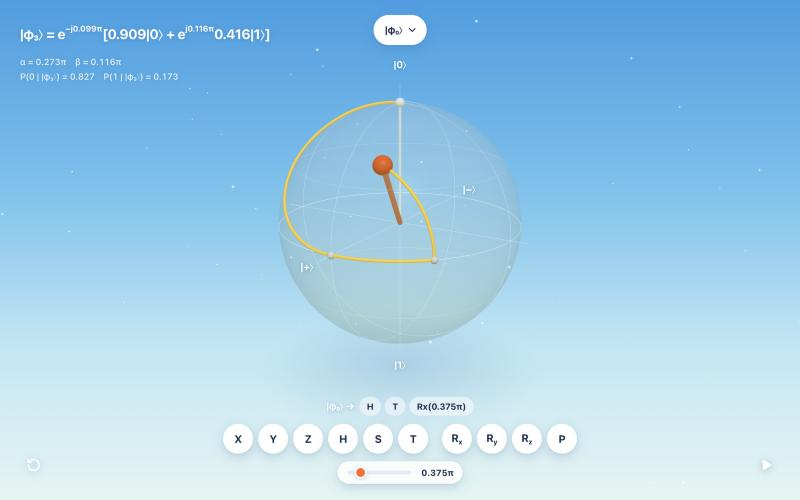

# Bloch Sphere Simulator

Homework of **Balázs Vojnárovits** and **Keve Farkas** for *Quantum Computing and its Applications*.

**Live:** <https://farkaskeve.github.io/bloch-simulator/>



## Run

- **Online:** open the link above.
- **Offline:** double-click `dist/index.html`. No installation needed.
- **From source:**

```bash
npm install
```

```bash
npm run dev
```

## Use

- Click a gate to add it to the circuit: X, Y, Z, H, S, T, Rx, Ry, Rz, P.
- The slider sets the angle for Rx, Ry, Rz and P.
- Use the **|φ₀⟩** button at the top to set the starting state.
- Click a gate in the circuit to remove it. **↺** clears the circuit, **▶** replays it.

Built with TypeScript, three.js and Vite.
